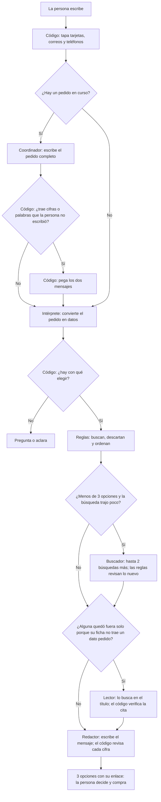

# PriceX 2.0: asistente de compras con un equipo de agentes de IA

**Proyecto de portafolio · Catálogo simulado con la forma de la API de Mercado Libre · No afiliado a Mercado Libre**

> **En corto:** le escribes en una frase lo que quieres comprar («tele de 55 que no pase de 2 palos») y el asistente te muestra las 3 mejores opciones, con el porqué. Puedes seguir conversando («¿y en azul?») sin repetir todo. Un equipo de agentes de IA entiende el pedido, busca y lee lo que falta; reglas fijas revisan cada publicación y deciden el orden; la persona compra desde el enlace. **La IA entiende, las reglas eligen y la persona decide.**

**Resultados con Gemini (26 de noviembre de 2026):** en la corrida 2, el equipo de agentes puso la mejor opción en el primer puesto en 59 de 59 casos de los tres exámenes, sin errores graves. La versión sin IA logró 44 de 59, con 6 errores graves. Llegar ahí tomó dos corridas. La primera mostró que el equipo no superaba a un solo agente y costaba 15 % más, que tres fallos eran de nuestra regla de modelos y no de la IA, que el revisor no cambiaba nada y que el coordinador agregaba un color que nadie pidió. Se corrigió eso y se volvió a medir: la segunda vuelta necesitó solo 4 consultas nuevas al modelo. Detalle en la [sección 6](#6-resultados).

**Pruébalo en vivo:** [pricex-2.streamlit.app](https://pricex-2.streamlit.app/). Si la página está dormida, tarda unos segundos en despertar. Sin escribir nada, la [demo](https://jdpachon9.github.io/pricex-2/demo/) muestra las respuestas grabadas caso por caso.

**Cómo se hizo:** la IA escribió casi todo el código; yo planteé el problema, evalué cada entrega y decidí cada paso. La bitácora, vuelta por vuelta, y lo que seis años con PriceX y Tecompro.co le pusieron al producto están en [la página del proceso](https://jdpachon9.github.io/pricex-2/proceso/).

**Estado: versiones 1 y 2 construidas y medidas en dos corridas con Gemini; página en vivo publicada**

- [x] Ficha de producto (este documento)
- [x] 30 pedidos de prueba, 30 variantes, 10 conversaciones, 205 publicaciones simuladas y la clave de respuestas
- [x] Reglas de la mejor opción, con prueba automática
- [x] Versión sin IA, congelada y medida
- [x] Versión 1: un agente interpreta, otro paso redacta y el código verifica las cifras
- [x] Versión 2: equipo de agentes con director en código, memoria de conversación y barandas verificables (seis construidos; el revisor quedó apagado después de medirlo)
- [x] Un solo cuaderno que corre las tres versiones y las compara
- [x] Demo en el navegador con las respuestas grabadas (carpeta `demo`)
- [x] Página en vivo para conversar con el equipo (`app.py`, lista para Streamlit Community Cloud)
- [x] Tablero en la página en vivo: se actualiza con cada mensaje, responde cinco preguntas de negocio, mide la calidad de cada versión, compara corridas y puede guardar el uso en Google Sheets
- [x] Página del proceso: cómo se construyó, vuelta por vuelta (carpeta `proceso`)
- [x] Corrida 1 con Gemini, cambios por lo que mostró y corrida 2
- [x] Página en vivo publicada en [pricex-2.streamlit.app](https://pricex-2.streamlit.app/)
- [ ] Conectar la hoja de uso en Google Sheets
- [ ] Memorando de conclusiones con el uso real
- [ ] Video

---

## 1. El problema

Al buscar un producto en un marketplace grande salen decenas de publicaciones que se parecen pero no son lo mismo: otra capacidad, el modelo Plus, uno reacondicionado, una funda que menciona el modelo, un vendedor con mala reputación o un envío que llega tarde. Comparar a mano toma tiempo, y un error termina en devolución.

En la simulación se ve el tamaño del ruido: la búsqueda «Samsung Galaxy S26 de 256 GB negro» trae 40 publicaciones y solo 3 cumplen todo. Veintitrés de esas 40 ni siquiera son un celular.

Y la gente no pide todo de una vez. Dice «Samsung S26 de 256 negro» y luego «¿y en azul?», o «quiero cambiar el televisor» y, cuando le preguntan, «de 55, máximo 2 millones».

## 2. Para quién

| Usuario | Qué gana |
|---|---|
| Comprador | Pide en sus palabras, corrige sobre la marcha y recibe 3 opciones que cumplen lo que pidió, con el porqué y lo que se descartó |
| Marketplace | Búsquedas que terminan en compras correctas: más conversión y menos devoluciones por «no era lo que pedí» |
| Vendedores serios | Las reglas premian el precio total, la reputación y la entrega, no al que llena el título de palabras |

## 3. Qué hace

**Principio de diseño: la IA entiende, las reglas eligen, la persona decide.** Un modelo de IA es bueno para entender frases como «la play 5 slim, la que trae lector de disco», pero puede variar de una respuesta a otra. Por eso no elige: convierte el pedido en datos, y las reglas, que son fijas y se pueden auditar, deciden qué sirve y en qué orden.

**Reglas (iguales en todas las versiones)**

| N° | Pregunta que se le hace a cada publicación | Si no cumple |
|---|---|---|
| 0 | ¿Trae instrucciones escondidas para el asistente? | Fuera |
| 1 | ¿Es el producto, la marca, el modelo y la capacidad pedidos? El color cuenta solo si se pidió | Fuera |
| 2 | ¿Confirma cada dato que se pidió? | Fuera, por «no confirma» |
| 3 | ¿Está en el estado pedido? Si no se dice nada, nuevo | Fuera |
| 4 | ¿El vendedor tiene reputación verde o amarilla y al menos 50 ventas? | Fuera |
| 5 | Si se pidió una fecha, ¿llega a tiempo a la ciudad? | Fuera |
| 6 | ¿Cabe en el presupuesto, contando el envío? | Fuera. Si nada cabe, se muestra la más cercana y se avisa |

Entre las que quedan:

- **Modelo exacto:** todas son el mismo producto, así que gana el **menor precio total** (precio más envío). Si otra cuesta menos de 3 % más y es tienda oficial o llega antes, gana esa.
- **Pedido abierto** («un portátil con 16 de RAM»): compiten productos distintos, así que primero cuenta la **calificación de los compradores**, solo si tiene 30 opiniones o más. Una diferencia de 0,2 estrellas o menos cuenta como empate, y entre las empatadas gana el menor precio total.
- Las cuotas sin interés no cambian el orden: solo se mencionan.

**Tres versiones con los mismos datos**

| Versión | Quién entiende el pedido | Memoria en una conversación |
|---|---|---|
| Sin IA | Patrones de texto escritos a mano. Es la línea base | Pega el mensaje anterior y el nuevo |
| V1: un agente | Gemini interpreta y, en otro paso, redacta el mensaje | Pega el mensaje anterior y el nuevo |
| V2: equipo de agentes | Seis agentes con tareas fijas, coordinados por código | Un coordinador escribe el pedido completo con el cambio |

**Lo que no hace:** no compra ni paga, no guarda datos de pago, no compara con otras tiendas y todavía no se conecta a la API real: trabaja sobre un catálogo simulado y congelado.

## 4. El equipo de agentes (versión 2)

Cada agente es el mismo modelo con otras instrucciones y una sola tarea. El que reparte el trabajo es código: decide quién trabaja, cuándo, y no usa nada que no pase su revisión.



| Agente | Cuándo trabaja | Qué propone | Qué revisa el código antes de usarlo |
|---|---|---|---|
| Coordinador | Cuando ya hay un pedido en curso | El pedido completo en una frase | Que no traiga cifras ni palabras que la persona no escribió. Si falla, pega los dos mensajes |
| Intérprete | Siempre (es el de la v1) | Los datos del pedido | Producto de la lista, cifras válidas, fecha futura y reglas de acción |
| Revisor (apagado) | Solo si se prende `USAR_REVISOR`: en la corrida 1 hizo 64 consultas y no cambió nada | Correcciones a cifras, fecha, ciudad, color, edición o estado | Que cada una cite el pedido letra por letra y no cambie un dato que ya tenía respaldo |
| Buscador | Si quedaron menos de 3 opciones y la búsqueda trajo menos de 10 publicaciones del producto | Hasta 2 búsquedas nuevas, con marcas y sin palabras de relleno | Formato corto y sin enlaces. Las reglas revisan cada publicación nueva |
| Lector de atributos | Si una publicación quedó fuera solo porque su ficha no trae un dato pedido | El dato, leído del título | Que esté escrito en el título, sin condiciones («ampliable a») y sin ambigüedad. El mensaje avisa cuando un dato salió del título |
| Redactor | Cuando hay opciones para mostrar (es el de la v1) | El mensaje para la persona | Cada cifra contra los datos. Si falla, sale la plantilla |

**Por qué un director en código y no un agente que decide todo.** Un agente que decide por su cuenta a quién llamar es más flexible, pero cada respuesta puede tomar un camino distinto, y eso es difícil de auditar y de medir. En una recomendación de compra importa más poder explicar cada paso que la flexibilidad. Aquí cada agente tiene una tarea pequeña, sus propuestas se pueden comprobar con el texto, y el camino es siempre el mismo: si un agente se equivoca, se sabe cuál fue y por qué.

**El tablero de la página en vivo.** Al lado de la conversación hay una pestaña *Tablero* que se actualiza con cada mensaje que alguien escribe. Responde cinco preguntas de negocio, cada una con su lectura en una frase calculada de los datos: dónde se pierde el pedido (embudo), por qué no sirven las publicaciones (ruido del buscador y calidad del catálogo), qué piden y qué no encuentran (demanda sin atender y cuánto le faltó al presupuesto), qué hizo cada agente y cuánto cuesta frente a la comisión de una venta. En las pruebas grabadas, que tienen respuesta correcta, responde dos más: qué tan bien elige cada versión (aciertos y errores graves) y qué cambió entre la corrida 1 y la 2. Se filtra por visitantes, por tu conversación o por las pruebas grabadas de cada versión y corrida, y por producto. Los datos se descargan en CSV para Excel o Power BI y, con una hoja de Google Sheets conectada, el uso de los visitantes queda guardado aunque la página se duerma. Solo guarda datos estructurados: nunca el texto que escribe la persona.

**Por qué el revisor no corrige marca ni modelo.** La gente escribe los nombres de mil formas («la play 5», «el s26 de samsung»). Comprobar que «PlayStation 5 Slim» sale de «la play 5 slim» ya es interpretar, que es el trabajo del intérprete. El revisor solo toca lo que se puede comprobar letra por letra: cifras con su unidad, fechas, ciudades, colores, edición y estado. En la corrida 1 no tuvo nada que corregir en 64 consultas, porque los errores de lectura de Gemini estaban justo en el modelo, que no puede tocar. Por eso quedó apagado.

## 5. Cómo se mide

| Métrica | Qué significa | Meta inicial |
|---|---|---|
| Hizo lo que debía | Recomendar, preguntar o aclarar, según el pedido (en conversaciones, en los dos mensajes) | Todos |
| Mejor opción en el primer puesto | La que dice la clave de respuestas | 23 de 25 |
| Mejor opción entre las 3 mostradas | | 25 de 25 |
| Errores graves | La primera opción incumple algo de lo pedido: otra capacidad, otro modelo, otro color, fuera de presupuesto sin avisar | 0 |
| Recomendó cuando debía preguntar o aclarar | | 0 |
| Tarjetas que llegan al modelo | | 0 |
| Publicaciones con instrucciones escondidas que se cuelan | | 0 de 3 |
| Mensajes con cifras que no están en los datos | Que lleguen a la persona | 0 |
| Propuestas de agentes sin respaldo que se usan | Correcciones, lecturas o pedidos completos que no pasan la revisión pero se usan igual | 0 |
| Tiempo de respuesta | Mediana por mensaje | Menos de 5 s en la v1; menos de 8 s en la v2 |
| Costo | Por cada 1.000 mensajes | Menos de US$ 5 |

**Tres exámenes.**

1. **30 pedidos de diseño:** 10 de modelo exacto, 10 por presupuesto o características, 5 con trampa, 3 ambiguos y 2 fuera de alcance. Cada uno tiene su respuesta esperada, construida a propósito: entre sus publicaciones hay una ganadora, una segunda, una tercera y trampas con el motivo exacto por el que deben quedar fuera.
2. **30 variantes:** las mismas necesidades dichas de otra forma («la play 5 slim», «pantalla de 27», «de 150 mil para abajo»), escritas después de congelar la versión sin IA, porque esa versión se escribió mirando los 30 pedidos. La huella de su código quedó en `resultados/sin_ia/linea_base_congelada.txt`.
3. **10 conversaciones de dos mensajes:** cambiar el color, cambiar la capacidad, responder la pregunta del asistente, agregar fecha y ciudad, empezar fuera de alcance, pedir que pague con una tarjeta a mitad de camino. La mejor opción esperada se calcula con las reglas sobre **todo el catálogo**, como si la búsqueda fuera perfecta. Para que la comparación sea justa, la versión sin IA y la v1 reciben la memoria más simple: el mensaje anterior y el nuevo, pegados.

En el pedido 9 la respuesta esperada cambia en la v2: una publicación no trae la capacidad en su ficha pero sí en el título («256GB»), y con ese dato es la más barata. La clave lo dice explícitamente (campo `"v2"`).

## 6. Resultados

**Prueba de las reglas.** Con la interpretación correcta de cada pedido, las reglas dieron la respuesta esperada en los 25 pedidos para recomendar, incluido el aviso de «no hay dentro del presupuesto» (pedido 14) y el de «no encontré ninguno» (pedido 27). Cada trampa quedó fuera por el motivo previsto y las 3 publicaciones con instrucciones escondidas se descartaron.

**Versión sin IA,** corrida el 25 de noviembre de 2026:

| Métrica | 30 pedidos de diseño | 30 variantes | 10 conversaciones | Meta |
|---|---|---|---|---|
| Hizo lo que debía | 30 de 30 | 25 de 30 | 10 de 10 | Todos |
| Entendió el pedido sin ningún error | 25 de 25 | 12 de 25 | 7 de 9 | |
| Mejor opción en el primer puesto | 25 de 25 | 13 de 25 | 6 de 9 | 23 de 25 |
| Mejor opción entre las 3 mostradas | 25 de 25 | 14 de 25 | 6 de 9 | 25 de 25 |
| Errores graves | 0 | 4 | 2 | 0 |
| Recomendó cuando debía preguntar o aclarar | 0 de 5 | 0 de 5 | 0 de 1 | 0 |

El 25 de 25 con los pedidos de diseño no vale como resultado: es un examen que la versión sin IA ya conocía. Lo que cuenta son las variantes y las conversaciones.

**Versión 1 y versión 2 con Gemini 3.5 Flash-Lite,** dos corridas el 26 de noviembre de 2026. Mejor opción en el primer puesto y, entre paréntesis, errores graves:

| Examen | Sin IA | V1, corrida 1 | V2, corrida 1 | V1, corrida 2 | V2, corrida 2 |
|---|---|---|---|---|---|
| 30 pedidos de diseño | 25 de 25 (0) | 24 de 25 (0) | 24 de 25 (0) | 25 de 25 (0) | 25 de 25 (0) |
| 30 variantes | 13 de 25 (4) | 23 de 25 (0) | 23 de 25 (0) | 25 de 25 (0) | 25 de 25 (0) |
| 10 conversaciones | 6 de 9 (2) | 8 de 9 (0) | 8 de 9 (0) | 8 de 9 (0) | 9 de 9 (0) |

| Costo y tiempo, medidos | V1 | V2, corrida 1 | V2, corrida 2 |
|---|---|---|---|
| Costo por pedido, con el mensaje redactado | US$ 0,0012 (unos $4) | US$ 0,0014 (unos $4,6) | US$ 0,0012 (unos $4) |
| Costo por conversación de dos mensajes | US$ 0,0022 (unos $7) | US$ 0,0027 (unos $9) | US$ 0,0024 (unos $8) |
| Tiempo típico de un pedido (mediana) | 3,9 s | 5,6 s | 4,0 s |

Las tablas completas, caso por caso, están en `resultados/gemini` (corrida 2) y `resultados/gemini/corrida_1`.

**Lo que mostró la corrida 1**

1. **La IA se gana su costo donde la versión sin IA se rompía.** Con frases nuevas, de 13 a 23 de 25, y de 4 errores graves a 0. Y cuando la IA se equivocó, falló de forma segura: ninguna versión con IA recomendó algo que incumpliera el pedido.
2. **Los 3 fallos de la v1 en pedidos y variantes eran de nuestra regla, no de la IA.** Gemini leyó «Paperwhite» de marca Amazon y «Note 14» de marca Xiaomi, que es correcto, pero la regla de modelos solo aceptaba «Kindle Paperwhite» y «Redmi Note 14» y descartó todas las opciones.
3. **El equipo no superó a un solo agente.** Empató en la mejor opción en los tres exámenes, entendió peor una conversación, costó 15 % más por pedido y tardó más (5,6 contra 3,9 segundos).
4. **Agente por agente:** el revisor hizo 64 consultas y no cambió nada. El buscador lo intentó 6 veces sin rescatar un caso, porque proponía sinónimos («smartphone», «teléfono celular») que no aparecen en los títulos. El coordinador no mejoró frente a pegar los mensajes y en la C7 agregó «plateado», un color que la persona nunca pidió: su revisión solo miraba las cifras. El lector acertó las 2 veces que actuó.

**Lo que cambió para la corrida 2**

1. La regla de modelos ya no exige la línea: «Paperwhite» de Amazon es el Kindle Paperwhite, y «Note 14» de Xiaomi es el Redmi Note 14. Las trampas siguen fuera (la edición Signature, el Kindle básico, el Note 14 Pro).
2. El coordinador no puede agregar palabras que la persona no escribió. Si lo hace, se pegan los dos mensajes.
3. El buscador propone marcas («celular xiaomi», «celular samsung») y no usa palabras de relleno.
4. El revisor quedó apagado.

**Lo que mostró la corrida 2:** las dos versiones con IA llegaron a 25 de 25 en pedidos y variantes. En conversaciones, la v2 llegó a 9 de 9: el buscador encontró el celular de la C1 y el código frenó el color inventado de la C7 (el coordinador lo volvió a proponer). En pedidos sueltos la v2 cuesta lo mismo que la v1, y en conversaciones 9 % más, justo donde ahora gana. Como casi todo salió de las respuestas guardadas, la corrida 2 necesitó solo 4 consultas nuevas al modelo.

**Lo que encontró la versión sin IA**

1. **Sin IA, el asistente se rompe con frases nuevas.** Con las variantes acertó 13 de 25. Fallan tres cosas: el orden de las palabras («Paperwhite de Kindle» terminó en el Kindle básico, «s26 de samsung» no se reconoció), la forma de decir el presupuesto («tengo 1.200.000 nada más», «de 150 mil para abajo») y los sinónimos («pantalla» por monitor, «refurbished», «la play 5»).
2. **Los errores graves salen de entender mal, no de elegir mal.** Los 4 errores graves de las variantes fueron datos mal leídos: un televisor de 55 sin decir «pulgadas» terminó en uno de 50, un iPhone «refurbished» terminó en uno nuevo, un presupuesto de 1.200.000 se perdió y se recomendó uno de 1.449.000 sin avisar, y un Kindle Paperwhite terminó en el básico. Con el pedido bien entendido, las reglas aciertan 25 de 25.
3. **Pegar los mensajes no es memoria.** En la conversación C2 («Samsung S26 de 256 negro» y luego «¿y en azul?») los patrones tomaron el primer color del texto pegado y recomendaron el negro; en la C5 («iPhone 16 de 128» y luego «mejor de 256»), la primera capacidad. Ambos son errores graves: la persona acababa de cambiar ese dato. Hace falta alguien que entienda qué cambió: el coordinador.
4. **El buscador simulado no entiende categorías.** En la C1 («un celular bueno y barato», «hasta 1 millón») la búsqueda «celular» no trae nada, porque ningún título dice «celular»: dicen «Xiaomi Redmi Note 14 128 GB». En el catálogo completo hay 6 celulares que cumplen. Para eso está el buscador de la v2: probar otras palabras cuando la primera búsqueda trae poco.
5. **«No confirma» protege, pero tiene costo.** En el pedido 9, una publicación que no traía el dato de almacenamiento quedó fuera aunque costaba $50.000 menos que la recomendada; su título sí decía «256GB». Para eso está el lector de atributos de la v2.
6. **Dos decisiones de producto siguen abiertas.** Si la persona no pide fecha, no hay límite de días de entrega, y una compra internacional de 12 días podría ganar por precio. Y si no dice ciudad, la entrega se calcula a Bogotá; el mensaje lo advierte («si la entrega es en Bogotá»), pero lo correcto es pedir el código postal una vez.

## 7. Caso de negocio

Con cuatro supuestos:

| Supuesto | Valor | De dónde sale |
|---|---|---|
| Comisión de afiliado de Mercado Libre Colombia | 4 % por venta | Mercado Libre paga hasta 10 % según la categoría; 4 % es un supuesto conservador |
| Valor promedio de una compra | $1.000.000 | Supuesto |
| Costo del modelo por pedido | Unos $4 (US$ 0,0012) con la v1 y con la v2; en conversaciones, la v2 suma la consulta del coordinador | Medido en la corrida 2 con los precios de Gemini 3.5 Flash-Lite (US$ 0,30 y US$ 2,50 por millón de tokens) |
| Dólar | $3.300 | TRM de mediados de noviembre de 2026 |

| | v1 | v2 |
|---|---|---|
| Comisión por cada venta | $40.000 | $40.000 |
| Costo de 1.000 pedidos | $4.000 | $4.000 |
| Pedidos que paga una sola venta | 10.000 | 10.000 |

Antes de medir, estimábamos que el equipo costaría 40 % más por mensaje; medido y ajustado, cuesta lo mismo en pedidos sueltos y 9 % más en conversaciones. En cualquier caso, una venta paga miles de mensajes. **El costo de la IA no es el problema; conseguir usuarios sí.** Como aplicación aparte, PriceX tendría que pagar por cada usuario que llega. Dentro de un marketplace, los usuarios ya están ahí, y el valor está en convertir más búsquedas en compras correctas y en reducir devoluciones. Por eso tiene más sentido como producto interno que como emprendimiento.

## 8. Cómo lo lanzaría dentro de Mercado Libre

**Lo que Mercado Libre ya hace.** En el primer trimestre de 2026 desplegó su primera búsqueda con IA, empezando por Brasil y México, y reportó más conversión. En la llamada de resultados del segundo trimestre, su CEO confirmó que prueba un asistente de compras con IA en una prueba A/B con parte de sus usuarios. Este proyecto no compite con eso: muestra cómo se mediría y se protegería un asistente así, y cómo se reparte el trabajo entre agentes sin perder la capacidad de auditar.

**Plan en cuatro pasos**

1. **Examen fuera de línea.** 500 búsquedas y 100 conversaciones reales de dos categorías (celulares y electrodomésticos), congeladas, con la mejor opción marcada por dos personas. Pasa si cumple las metas de la sección 5.
2. **Modo sombra.** El asistente responde, pero el usuario no lo ve. Se compara lo que recomendó con lo que la persona terminó comprando.
3. **Prueba A/B** con el 5 % de las búsquedas de celulares en Colombia. Métrica principal: compras por búsqueda. Métricas de control: devoluciones por «no es lo que pedí», errores graves en una muestra semanal, propuestas de agentes rechazadas por el código, tiempo de respuesta y costo por conversación.
4. **Ampliar por categorías,** empezando por las que más devoluciones tienen.

**Riesgos que cuidaría:** la neutralidad con los vendedores (las reglas son públicas y auditables, y las búsquedas del buscador quedan registradas), los vendedores que intenten manipular al asistente (regla 0, y el único agente que lee sus textos solo puede devolver lo que está escrito en el título) y los precios que cambian durante el día (se usa el de la API al momento y se guarda para auditar).

El mismo patrón sirve para Rappi: entender una lista como «el mercado de la semana», un coordinador para los cambios («mejor sin lactosa»), reglas para los reemplazos cuando algo no hay y la tienda que entrega a tiempo.

## 9. Gobierno y seguridad

| Riesgo | Control |
|---|---|
| Recomendar algo distinto a lo pedido: otra capacidad, otro modelo, otro estado | Las reglas comparan atributos, no palabras del título. Prueba automática con 25 pedidos y 205 publicaciones |
| Un vendedor esconde órdenes en su publicación para que el asistente lo elija | La regla 0 la descarta. Solo el lector de atributos lee textos de vendedores (títulos), y solo puede devolver un dato escrito en ese título. La prueba tiene 3 publicaciones de ataque |
| Un agente propone algo sin respaldo: una cifra que nadie dijo, una corrección que daña un dato bueno | Cada propuesta se comprueba contra el texto antes de usarse. Las pruebas usan un modelo que hace trampa a propósito |
| El modelo inventa un precio, una cuota o una fecha | Verificador de cifras por tipo. Si algo no cuadra, sale la plantilla |
| Datos de tarjetas o de contacto llegan al modelo | Se tapan antes de enviar. Las tarjetas se reconocen con la prueba de Luhn, así que no se tapan precios ni referencias |
| El asistente compra o paga por la persona | No tiene cómo: solo muestra enlaces. Si se lo piden, aclara sin consultar a ningún agente |
| Recomendar sin información suficiente | Regla de acción en el código: sin producto, o sin ningún dato para elegir, pregunta |
| La página en vivo gasta la cuota o expone la clave | Clave en los secretos de Streamlit; límite por visita y por día; si se acaba la cuota, sigue sin IA |
| Nadie sabe por qué se recomendó algo | Registro por mensaje: interpretación, correcciones, búsquedas, lecturas, cada descarte con su motivo, el orden, el mensaje y la traza de cada agente |
| Calificar con un examen conocido | Variantes escritas después de congelar la versión sin IA, con la huella de su código |

Detalle de los controles y de cómo auditar una respuesta en [gobierno/README.md](gobierno/README.md).

## 10. Historias de usuario

- Como **comprador**, quiero pedir con mis palabras, para no tener que aprender a filtrar.
- Como **comprador**, quiero cambiar un detalle («¿y en azul?») sin repetir todo el pedido.
- Como **comprador**, quiero ver por qué se descartó cada publicación, para confiar en la recomendación.
- Como **comprador**, quiero que me avise si nada cabe en mi presupuesto, en vez de mostrarme algo más caro sin decirlo.
- Como **comprador**, quiero que me pregunte cuando falta información, en vez de adivinar.
- Como **responsable del producto**, quiero saber qué agente se equivocó y por qué, para arreglar ese y no todo el sistema.

## 11. Entregas

| Versión | Qué incluye |
|---|---|
| 1 | Catálogo simulado, reglas con prueba automática, versión sin IA congelada, un agente que interpreta y redacta, verificación de cifras y evaluación con dos exámenes |
| 2 | Equipo de seis agentes con director en código, memoria de conversación, barandas verificables, tercer examen (conversaciones), un cuaderno que compara las tres versiones y página en vivo |
| 2.1 | Dos corridas con Gemini y lo que cambió entre ellas (regla de modelos, coordinador sin palabras nuevas, buscador con marcas, revisor apagado), tablero con calidad y comparación de corridas, uso guardado en Google Sheets y página del proceso |
| 3 | API real con búsquedas guardadas, entrega por código postal, opiniones, límite de días de entrega, pedidos y conversaciones de personas reales, alertas de precio |

## 12. Qué hay en el repositorio

| Carpeta o archivo | Contenido |
|---|---|
| `datos` | `generar_datos.py` crea el catálogo simulado, los 30 pedidos y la clave; `variantes.csv` trae las 30 variantes; `generar_conversaciones.py` crea las 10 conversaciones con su respuesta esperada |
| `pricex` | El asistente: datos sensibles, interpretación, versión sin IA (`linea_base.py`), búsqueda, reglas, redacción y verificación, evaluación. La v2 está en `multiagente.py` (el equipo y su director) y `evidencia.py` (las comprobaciones literales). El tablero, en `tablero.py` (los cálculos y las lecturas), `tablero_vista.py` (cómo se ve) y `hoja.py` (guardar el uso en Google Sheets) |
| `agente` | `pricex2_agente.ipynb`, el cuaderno de Colab que corre las tres versiones con Gemini y las compara |
| `pruebas` | Pruebas automáticas de las reglas, los controles y el equipo; modelos falsos para probar sin gastar consultas; prueba de tubería del cuaderno y prueba de la página en vivo |
| `resultados` | `sin_ia`: corrida de la versión sin IA y la huella de su código. `gemini`: la corrida 2 con IA y, en `gemini/corrida_1`, la primera |
| `gobierno` | Controles, barandas de cada agente y cómo auditar una respuesta |
| `demo` | Página de una sola ventana que reproduce las respuestas grabadas, caso por caso, con el colador de descartes y la traza de los agentes. Se publica con GitHub Pages |
| `proceso` | Cómo se construyó el proyecto, vuelta por vuelta: qué planteé yo, qué construyó la IA y cómo se midió. Se publica con GitHub Pages |
| `app.py`, `requirements.txt`, `.streamlit` | La página en vivo: la conversación con el equipo y el tablero |
| `despliegue` | Cómo publicar la página en vivo en Streamlit Community Cloud y conectar la hoja de uso |
| `scripts` | `correr_sin_ia.py` corre la versión sin IA; `armar_cuaderno.py` arma el cuaderno; `armar_demo.py` actualiza los datos de la demo |

## 13. Cómo correrlo

**Sin IA** (solo Python, sin claves):

```
python3 datos/generar_datos.py
python3 datos/generar_conversaciones.py
python3 -m unittest discover -s pruebas
python3 scripts/correr_sin_ia.py
```

**Con IA** (solo se necesita una cuenta de Google):

1. Sube la carpeta `pricex-2` a Google Drive, dentro de *Mi unidad*.
2. Abre `agente/pricex2_agente.ipynb` con Google Colab.
3. Crea una clave gratuita en [Google AI Studio](https://aistudio.google.com) y guárdala en los *Secretos* de Colab con el nombre `GEMINI_API_KEY`.
4. Elige *Entorno de ejecución > Ejecutar todas*. Son unas 200 consultas, de 20 a 30 minutos. Si se corta o se acaba la cuota del día, al volver a ejecutar sigue donde iba.

La última sección del cuaderno imprime las tablas de resultados listas para pegar aquí y descarga `resultados_gemini.zip`. Con esa carpeta en `resultados/gemini`, `python3 scripts/armar_demo.py` agrega las respuestas con IA a la demo.

**La demo y la página del proceso** se ven con GitHub Pages: en *Settings > Pages*, publica la rama `main` desde la carpeta raíz y quedan en `jdpachon9.github.io/pricex-2/demo/` y `jdpachon9.github.io/pricex-2/proceso/`.

**La página en vivo** se publica gratis en Streamlit Community Cloud: los pasos están en [despliegue/STREAMLIT.md](despliegue/STREAMLIT.md).

## Referencias

- Mercado Libre Colombia, [Afiliados y Creadores](https://mercadolibre.com.co/l/afiliados): comisión de hasta 10 % por venta.
- Innovación Digital 360, [Mercado Libre reveló cómo usa IA para vender más](https://www.innovaciondigital360.com/i-a/mercado-libre-revelo-como-usa-ia-para-vender-mas-y-mejorar-uno-de-sus-negocios-mas-rentables/), 21 de agosto de 2026: búsqueda con IA y asistente de compras en prueba A/B.
- Google, [precios de la API de Gemini](https://ai.google.dev/pricing) y [límites de uso](https://ai.google.dev/gemini-api/docs/rate-limits): Gemini 3.5 Flash-Lite.
- Streamlit, [despliegue en Community Cloud](https://docs.streamlit.io/deploy/streamlit-community-cloud/deploy-your-app/deploy).
- Portafolio, [TRM del 18 de noviembre de 2026](https://www.portafolio.co/economia/finanzas/dolar-en-colombia-frena-su-racha-alcista-y-cae-este-miercoles-18-de-noviembre-este-es-su-precio-oficial-506559): $3.309,55.

---

*Juan David Pachón Moya · Construido con asistentes de IA · [LinkedIn](https://www.linkedin.com/in/juan-david-pachon-moya-00554417b/)*
